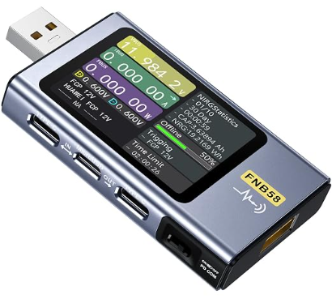
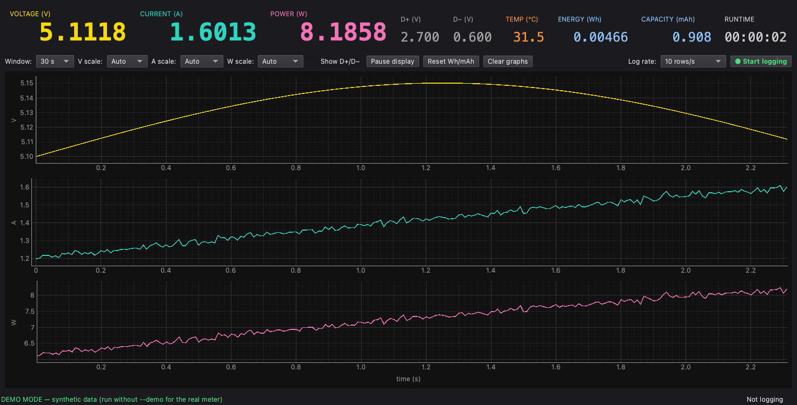

# FNIRSI FNB58 USB Power Meter — macOS Logger & GUI

Native macOS tooling for the [FNIRSI FNB58 USB tester](https://a.co/d/0b5f4zDf)
— the Mac equivalent of FNIRSI's Windows-only `UsbMeter.exe`. Live
measurements, waveform charts with adjustable scaling, and CSV logging.
No kernel extension or driver needed — the meter is a plain USB HID device.

<p align="center">
  
</p>

Also works with the **FNB48, FNB48S, and C1** (auto-detected by USB VID/PID),
and falls back to any HID device identifying as FNIRSI/FNB (e.g. FNB-C2).

## GUI



```sh
.venv/bin/python usbmeter_gui.py          # auto-connects, reconnects on unplug
.venv/bin/python usbmeter_gui.py --demo   # synthetic data, no meter needed
```

- Big live readouts: V / A / W, D+ / D−, temperature, energy (Wh), capacity (mAh), runtime
- Three scrolling charts (voltage, current, power) at the meter's full 100 samples/s
- Scaling like the original app: time window (10 s … 1 h / All), per-chart
  Y-scale selectors (Auto or fixed ranges), plus free mouse-wheel zoom and drag pan
- Optional D+/D− overlay, pause display, clear graphs, reset Wh/mAh
- **● Start logging / ■ Stop logging** → CSV at 1, 10, or 100 rows/s

## Setup (one time)

```sh
brew install hidapi
git clone https://github.com/sajingeo/fnirsi-usb-meter-mac.git
cd fnirsi-usb-meter-mac
python3 -m venv .venv
.venv/bin/pip install hid PySide6 pyqtgraph numpy
```

Connect the meter's **PC/data port** (not the pass-through measurement ports)
to the Mac.

## CLI logger

```sh
.venv/bin/python usbmeter.py                 # live readout + usbmeter_<ts>.csv
.venv/bin/python usbmeter.py -o run1.csv     # choose the output file
.venv/bin/python usbmeter.py --avg 1         # log all 100 samples/s (default: 10 rows/s)
.venv/bin/python usbmeter.py --duration 300  # stop after 5 min
.venv/bin/python usbmeter.py --quiet         # CSV only, no live line
```

Ctrl-C stops and prints totals. CSV columns: `timestamp, elapsed_s, voltage_V,
current_A, power_W, dp_V, dn_V, temp_C, energy_Wh, capacity_mAh`.

## Plotting a log

```sh
.venv/bin/pip install matplotlib   # once
.venv/bin/python plot_log.py run1.csv            # interactive window
.venv/bin/python plot_log.py run1.csv -o run1.png
```

## Protocol notes

Reverse-engineered protocol, credit to
[baryluk/fnirsi-usb-power-data-logger](https://github.com/baryluk/fnirsi-usb-power-data-logger) (MIT):

- Init: write 64-byte HID output reports `AA 81 … 8E`, `AA 82 … 96`, then
  `AA 83 … 9E` (FNB48/C1) or `AA 82 … 96` again (FNB58/FNB48S).
- Keep-alive: rewrite `AA 83 … 9E` every ~3 ms (FNB48/C1) or 1 s (FNB58/FNB48S).
- Data: 64-byte input reports; `AA 04` packets hold 4 samples × 15 bytes:
  u32 LE voltage (÷100000 V), u32 LE current (÷100000 A), u16 D+ (÷1000 V),
  u16 D− (÷1000 V), 1 unknown byte, u16 temperature (÷10 °C). Last byte is a
  CRC-8 (poly 0x39, init 0x42) over bytes 1..62.
- Known IDs: FNB48 `0483:003A`, C1 `0483:003B`, FNB58 `2E3C:5558`,
  FNB48S `2E3C:0049`.

## License

MIT — see [LICENSE](LICENSE).
